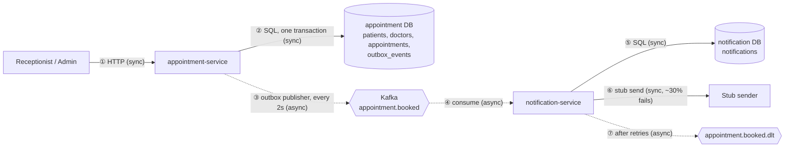

# Design

Two separate Spring Boot applications that share **no code and no database**; the only link is a JSON event on Kafka.

## 1. Architecture: synchronous vs asynchronous



Solid arrows are synchronous (the caller waits). Dotted arrows are asynchronous. The user's request ends at step ② and never waits for Kafka or for the notification.

## 2. Data model and indexes

**appointment-service** (PostgreSQL)

| Table | Columns (main) | Indexes / constraints |
|---|---|---|
| `patients` | `patient_id` PK, first_name, last_name, date_of_birth, email, phone | `idx_patient_last_name`, `idx_patient_first_name` (name search) |
| `doctors` | `doctor_id` PK, name, specialization (seeded by migration, ids 201-204) | PK |
| `appointments` | `appointment_id` PK, `patient_id` FK, `doctor_id` FK, `start_time` (clinic local time), `status` BOOKED / CANCELLED | `idx_appt_doctor_status (doctor_id, status)`; **`no_overlapping_bookings`** exclusion constraint (section 3) |
| `outbox_events` | `id` PK, `event_id` UUID, topic, event_key, payload (JSON), `status` PENDING / PUBLISHED, created_at, published_at, attempts, last_error | `event_id` UNIQUE, `idx_outbox_status_id (status, id)` for "oldest pending first" |

**notification-service** (own PostgreSQL)

| Table | Columns (main) | Indexes / constraints |
|---|---|---|
| `notifications` | `id` PK, `event_id` UUID, appointment_id, patient_id, doctor_id, message, `status` PENDING / SENT / DEAD_LETTERED, attempts, created_at, sent_at, last_error | **`event_id` UNIQUE** (the idempotency key) |

Both schemas are managed by Flyway migrations.

## 3. How double-booking is prevented

The guarantee lives in the **database**, not in application code, so it holds for simultaneous requests and for several app instances:

```sql
EXCLUDE USING gist (
    doctor_id WITH =,
    tsrange(start_time, start_time + interval '30 minutes') WITH &&
) WHERE (status = 'BOOKED')
```

1. Two bookings for the same doctor whose 30-minute windows overlap cannot both exist. PostgreSQL serialises the competing inserts: one commits, the others fail.
2. `AppointmentService.book` uses `saveAndFlush`, so the violation surfaces immediately and is translated to **HTTP 409**.
3. The `WHERE status = 'BOOKED'` clause means **cancelled rows do not block the slot**, so a cancelled slot can be booked again.
4. Before the insert the service checks the start time is in the future and on a 30-minute boundary (400 otherwise), and that the patient and doctor exist (404).

Proven by `AppointmentBookingTest`: 20 parallel requests for one doctor and slot give exactly one 201 and nineteen 409.

## 4. Example event

Topic `appointment.booked`, key = appointment id:

```json
{
  "eventId": "6f1c3a52-8f0e-4a0e-9d57-2d0b5d6c1a11",
  "eventType": "AppointmentBooked",
  "occurredAt": "2026-11-01T08:00:00Z",
  "appointmentId": 7,
  "patientId": 101,
  "doctorId": 201,
  "startTime": "2026-11-02T10:00:00"
}
```

It carries only ids (no names, email or phone). The notification text built from it is:
*"Appointment booked for patient P101 with doctor D201 at 2026-11-02T10:00."* Each service has its own copy of the event class; unknown fields are ignored so the producer can evolve.

## 5. Duplicates, retries and Kafka being down

**Never lose an event (transactional outbox).** The booking and its `outbox_events` row are saved in the *same* database transaction (the outbox method requires an existing transaction). Either both exist or neither. A background publisher sends `PENDING` rows to Kafka oldest first, with `acks=all` and an idempotent producer, then marks them `PUBLISHED`.

**Kafka is down (for minutes).**
- Producer timeouts are a few seconds and only the background publisher talks to Kafka, so **booking is not affected**.
- The receptionist sees the normal **201 Created**; nothing in the response says "notification pending".
- The event stays `PENDING` (attempts and last error recorded). The publisher retries every 2 seconds, stops the batch on the first failure to keep order, and sends everything once Kafka returns.
- The patient's notification is **delayed, not lost**. The delay is visible as `PENDING` rows in `outbox_events`.

**Duplicates.** Delivery is at-least-once (e.g. the app dies after Kafka accepted a message but before the row is marked `PUBLISHED`). The consumer stores the notification first, keyed by the unique `event_id`:
- seen before and `SENT`: ignored, nothing is sent again;
- seen before and not sent: only the send is retried;
- two copies racing: the unique constraint rejects the second insert and it reuses the stored row.

Proven by `NotificationIdempotencyTest` (same event twice, and 10 simultaneous deliveries, give one notification).

**Retries and dead-letter.** The stub sender fails ~30% of the time. A failed send is recorded (`attempts`, `last_error`) and the Kafka listener retries with back-off **1s, 2s, 4s (3 retries)**, then publishes the record to `appointment.booked.dlt` and marks the notification `DEAD_LETTERED`. Unreadable or incomplete events are not retried and go straight to the dead-letter topic. The offset is committed only after success or dead-lettering, and if publishing to the dead-letter topic itself fails the record is redelivered, so retries are bounded and nothing is dropped.

## Known gaps in messaging (understood, not yet implemented)

Handled: a permanent publish error (record too large, serialization, invalid topic) parks only that outbox row as `FAILED` instead of blocking later events; a permanent dead-letter write failure is logged in full and skipped so a partition is not blocked; permanent send errors (`PermanentSendException`) skip the retries; every sender exception is recorded in `attempts` / `last_error`.

Still needs implementation:

| # | Gap | Planned fix |
|---|---|---|
| 1 | **A database outage in the consumer longer than ~7s dead-letters healthy events** (all errors except `InvalidEventException` and `PermanentSendException` use the 1s/2s/4s retries). If the outage also hits `markDeadLettered`, the error is swallowed and the row stays `PENDING` while the event is in the DLT. | Treat database errors as infrastructure failures: retry with a longer capped back-off and never dead-letter. Do not swallow the `markDeadLettered` failure. |
| 2 | **No alerts or metrics.** Nothing signals `FAILED` outbox rows, an old `PENDING` row, dead-letter volume, a skipped dead-letter write (only a log line, so that is the one data-loss path) or consumer lag. | Add actuator and Micrometer gauges (`FAILED` count, oldest `PENDING` age, DLT count) with alert rules. |
| 3 | **The outbox publisher holds a database transaction and row locks while waiting on Kafka**, so a slow Kafka can exhaust the connection pool. | Claim rows in a short transaction, send outside it, then record the results (needs a `PUBLISHING` state and reclaim of stale claims). |
| 4 | **No replay tool for the dead-letter topic**, and its retention is Kafka's default (7 days). | Opt-in replay runner that republishes the DLT to the original topic, plus a longer retention on the DLT. |
| 5 | **`FAILED` outbox rows need manual attention** (fix or delete); nothing retries or reports them. | Covered by the alerting above; add an admin action to requeue a row. |

Also unaddressed: unbounded outbox retries while Kafka is down (each failed poll writes to the database and logs a warning); `outbox.*` keys in `application.yaml` sit under `spring:` so they do not bind (the code defaults match, so behaviour is unchanged); the dead-letter topic has one partition; no `eventType` check in the consumer; no `restart:` policy in compose; listener concurrency is 1; `min.insync.replicas=2` needs a multi-broker cluster.

## 6. What I would add for production

Real authentication (signed JWTs from an identity provider instead of the mock `X-Role` header) and authentication on the notification endpoint; a replicated Kafka cluster with TLS and a schema/versioning policy for events; metrics, tracing and alerts on the age of `PENDING` outbox rows and on dead-letter volume; a tool to replay dead-lettered events; clean-up of old `PUBLISHED` outbox rows; a real email/SMS provider with rate limits and consent handling; doctor working hours, holidays and rescheduling; pagination on the appointment list; and CI that runs the tests and a container build on every change.
