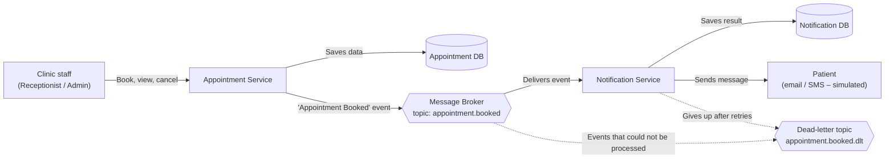
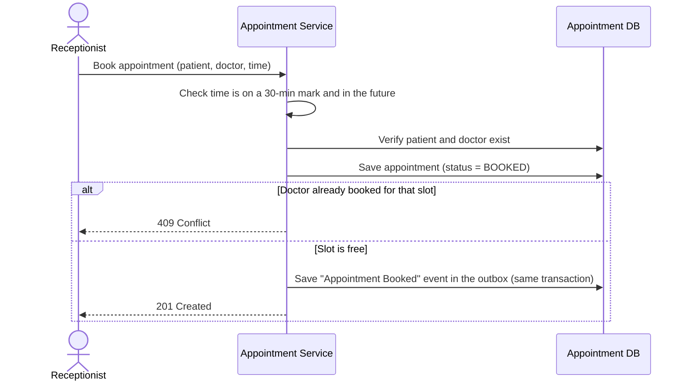
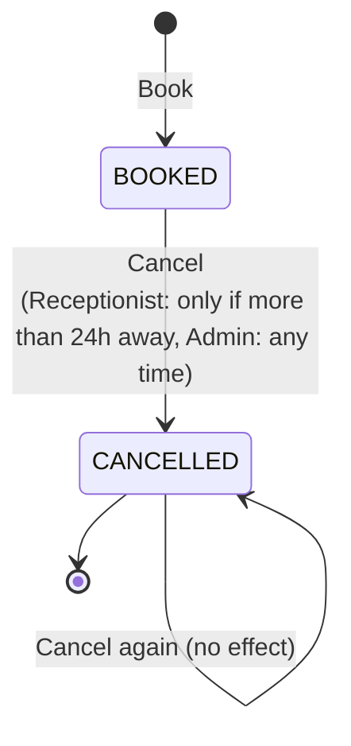
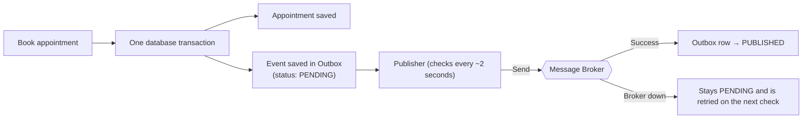
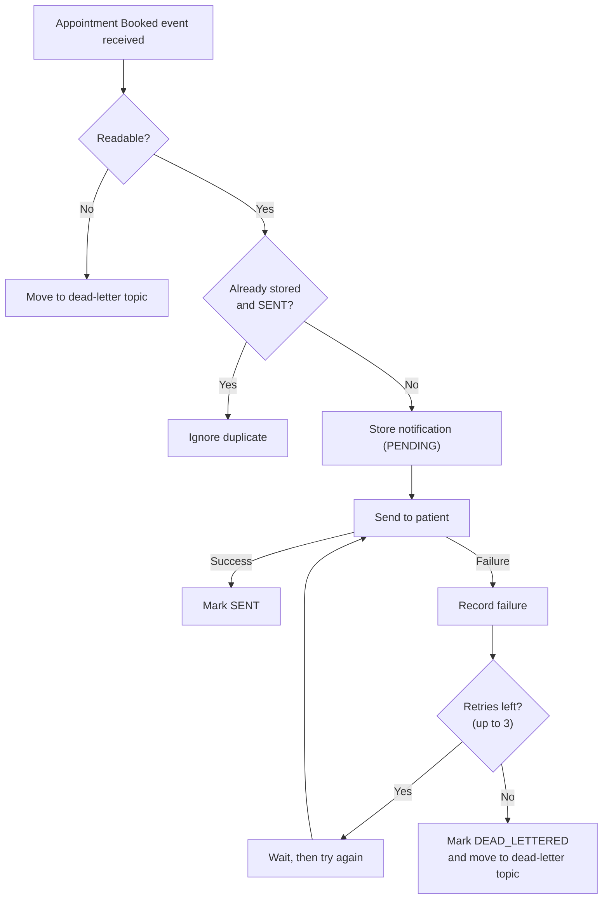
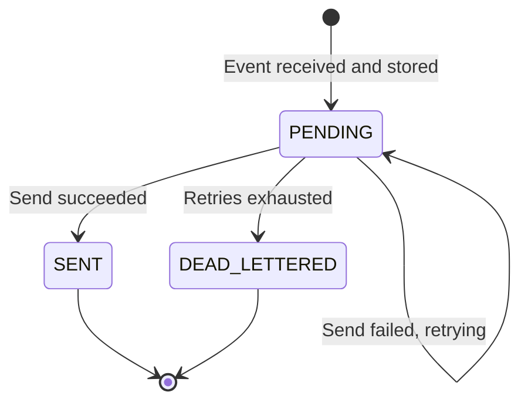
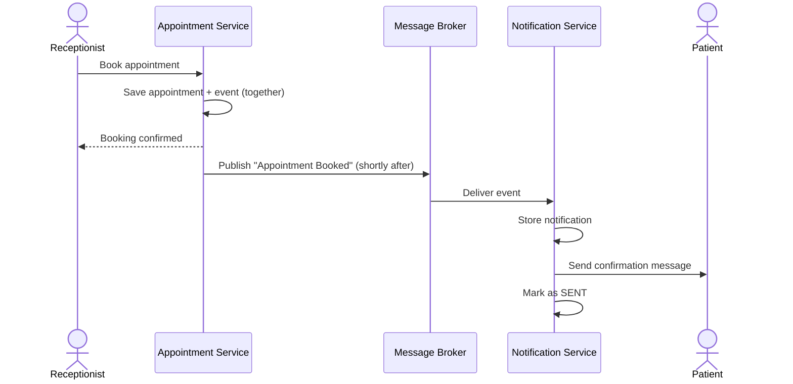

# Clinic Appointment System – Architecture

The system is made of two independent services that talk to each other only through events.

| Service | Purpose |
|---|---|
| **Appointment Service** | Manages patients, doctors and appointments (book / view / cancel). |
| **Notification Service** | Reacts to newly booked appointments and notifies the patient. |

## 1. Big Picture

- The two services share **no code and no database**; the only contract is the *Appointment Booked* event.
- If the Notification Service is down, bookings still work and notifications are delivered later.

---

## 2. Appointment Service

### 2.1 Features

| Area | What it does |
|---|---|
| **Patients** | Register a patient; search patients by name (paged). |
| **Doctors** | List the available doctors (pre-loaded in the system). |
| **Appointments** | Book a slot with a doctor, list appointments (filter by doctor and/or status), cancel an appointment. |
| **Event publishing** | Every successful booking produces an *Appointment Booked* event for the Notification Service. |

### 2.2 Who can do what

| Action | Receptionist | Admin |
|---|:---:|:---:|
| Register / search patients | ✅ | ✅ |
| View doctors | ✅ | ✅ |
| Book / view appointments | ✅ | ✅ |
| Cancel appointment (more than 24h away) | ✅ | ✅ |
| Cancel appointment (within 24h) | ❌ | ✅ |
| Any other endpoint | ❌ | ✅ |

Callers identify their role with a header (mock authentication); a missing or unknown role is rejected as *Unauthorized*, and a role without permission is *Forbidden*.

### 2.3 Booking rules

- Appointments are **30 minutes** long and must start on a 30-minute mark (e.g. 10:00, 10:30).
- The start time must be **in the future** (clinic time zone: Asia/Kolkata).
- The patient and the doctor must exist.
- A doctor **cannot be double-booked**; overlapping slots are rejected (enforced by the database, so it holds even with simultaneous requests).
- Cancelled slots become available again.

### 2.4 Booking flow

### 2.5 Appointment lifecycle

### 2.6 Reliable event publishing (Outbox)

To make sure an event is never lost *and* never sent for an appointment that failed to save, the event is stored together with the appointment, then forwarded separately.

- Delivery is **at least once**: an event may occasionally be sent twice, which the Notification Service handles.
- A slow or unavailable broker never delays or fails a booking.

### 2.7 The event shared between services

| Field | Meaning |
|---|---|
| Event id | Unique id, used to detect duplicates |
| Event type | `AppointmentBooked` |
| Occurred at | When the booking happened |
| Appointment, Patient, Doctor ids | Who and what was booked |
| Start time | Appointment time (clinic local time) |

---

## 3. Notification Service

### 3.1 Features

| Area | What it does |
|---|---|
| **Listen** | Subscribes to the *Appointment Booked* topic. |
| **Store** | Saves one notification per event, with its status and number of attempts. |
| **Send** | Sends a message such as *"Appointment booked for patient P1 with doctor D2 at 2026-10-20T10:30."* (delivery is simulated and randomly fails ~30% of the time to exercise retries). |
| **Retry** | Retries failed sends with increasing waits (1s → 2s → 4s). |
| **Dead-letter** | After all retries fail, marks the notification `DEAD_LETTERED` and moves the event to a dead-letter topic so nothing is silently lost. |
| **No duplicates** | A repeated event is recognised by its id and is not sent twice. |
| **Inspect** | A read-only list of notifications, filterable by status (for development only, no authentication). |

### 3.2 Processing flow

### 3.3 Notification lifecycle

---

## 4. End-to-End Journey

## 5. Guarantees at a Glance

| Guarantee | How it is achieved |
|---|---|
| No double-booking of a doctor | Database rule on doctor + time slot |
| No event without a booking, and no booking without an event | Outbox saved in the same transaction as the booking |
| Booking is not blocked by messaging problems | Events are sent in the background and retried |
| No notification sent twice | Unique event id checked by the Notification Service |
| No event silently lost | Retries, then dead-letter topic |
| Services can evolve independently | Separate code, separate databases, shared event only |
